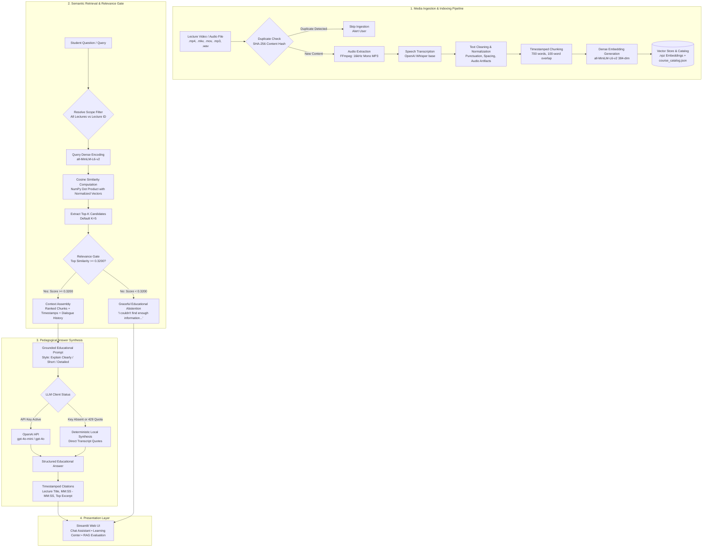

# System Architecture: RAG-Based AI Teaching Assistant

## Architecture Overview

The **RAG-Based AI Teaching Assistant** follows a decoupled, pipeline-based architecture designed for reproducible indexing, low-latency dense retrieval, disciplined relevance gating, and grounded educational response generation.

The system is composed of two primary workflows:
1. **Knowledge Ingestion & Indexing Pipeline (Offline/Incremental):** Transforms raw educational media files into timestamped, vector-indexed chunks managed by a persistent course catalog.
2. **Grounded Query & Pedagogical Synthesis Pipeline (Online/Real-Time):** Processes student queries, executes vector similarity search across filtered or full course scopes, enforces a relevance gate, and synthesizes grounded answers with timecode citations.

---

## Complete Pipeline Diagram



---

## Core Pipeline Subsystems

### 1. Media Extraction (`src/audio/extractor.py`)
- **Input:** Video files (`.mp4`, `.mkv`, `.mov`, `.avi`, `.webm`) or audio files (`.mp3`, `.wav`, `.m4a`).
- **Processing:** Video files are decoded using FFmpeg (`is_ffmpeg_available()`). The audio stream is normalized to **16,000 Hz, mono channel, 64 kbps MP3**, matching Whisper’s internal acoustic model input.
- **Safety:** Filenames are sanitized via `sanitize_filename()` to neutralize path traversal patterns.

### 2. Timestamped Transcription (`src/transcription/`)
- **Model:** OpenAI Whisper (`base` model by default, configurable via `WHISPER_MODEL`).
- **Output:** Raw segment objects containing start time (`start`), end time (`end`), spoken text (`text`), and segment identifiers.
- **Cleaning (`processor.py`):** Strips repeated acoustic filler words, normalizes whitespace and punctuation, and verifies audio duration consistency.

### 3. Semantic Chunking & Metadata Tagging (`src/chunking/chunker.py`)
- **Strategy:** Word-based sliding-window chunking (default: `CHUNK_SIZE = 700` words, `CHUNK_OVERLAP = 100` words).
- **Temporal Mapping:** Reconstructs the exact start timestamp (`timestamp_start`) and end timestamp (`timestamp_end`) for every chunk based on the underlying transcribed speech segments.
- **Metadata Tagging:** Every chunk record includes:
  ```json
  {
    "chunk_id": "python_lecture_0001",
    "lecture_id": "python_lecture",
    "lecture_title": "Python Lecture",
    "course_id": "python_course",
    "source_filename": "python_lecture.mp3",
    "timestamp_start": "00:00",
    "timestamp_end": "04:32",
    "start_seconds": 0.0,
    "end_seconds": 272.5,
    "word_count": 684,
    "text": "..."
  }
  ```

### 4. Vector Embeddings (`src/embeddings/embedder.py`)
- **Model:** Sentence-Transformers `all-MiniLM-L6-v2` (384 dimensions).
- **L2 Normalization:** Embeddings are normalized such that $\|v\|_2 = 1.0$. This transforms cosine similarity into a dot product:
  $$\text{Cosine Similarity}(u, v) = u \cdot v$$
- **Storage:** Vectors are serialized to compressed NumPy archives (`.npz`) paired with parallel JSON metadata files (`_metadata.json`).

### 5. Multi-Lecture Course Knowledge Base (`src/data/course_catalog.py`)
The `CourseCatalog` class maintains a persistent, multi-lecture registry (`data/course_catalog.json`):
- **SHA-256 Deduplication:** Computes deterministic content hashes of ingested media (`compute_file_hash()`). If a student uploads a duplicate file under a different filename, the system identifies the collision and skips redundant transcription.
- **Lecture Scoping & Filtering:** Queries can target a specific `lecture_id` or search across `All Lectures`.
- **Portable Dynamic Path Resolution:** Replaces machine-specific absolute paths with portable relative paths, automatically healing broken references across different operating systems.

### 6. Semantic Retrieval (`src/retrieval/retriever.py`)
- **Query Encoding:** Encodes the student's question into the same 384-dimensional latent space.
- **Scope Masking:** If a specific lecture scope is selected, candidates outside the targeted `lecture_id` are masked out.
- **Ranking:** Computes cosine similarity scores, sorts candidates in descending order, and extracts the top $K$ chunks (default: $K=5$).

### 7. Relevance Gate & Abstention (`src/rag/pipeline.py`)
- **Cutoff:** `DEFAULT_RELEVANCE_THRESHOLD = 0.3200`.
- **Decision Rule:**
  $$\text{Relevance Decision} = \begin{cases} \text{RELEVANT} & \text{if } \max_{i} (\text{score}_i) \ge 0.3200 \\ \text{NOT RELEVANT} & \text{if } \max_{i} (\text{score}_i) < 0.3200 \end{cases}$$
- **Abstention Behavior:** When rejected, answer synthesis is bypassed entirely, eliminating hallucination risks and saving external API tokens.

### 8. Pedagogical Synthesis (`src/rag/prompt.py` & `src/llm/client.py`)
- **Prompt Engineering:** Assembles retrieved passages with temporal identifiers into a strict system prompt:
  - Instructs the model to rely solely on the provided course material.
  - Prohibits assumptions or external knowledge extrapolation.
  - Supports conversation history for contextual follow-up questions.
  - Formats responses according to selected teaching styles (**Explain Clearly**, **Short Answer**, **Detailed Explanation**).
- **Graceful Fallback:** If the OpenAI API key is missing or quota is exhausted (HTTP 429), `RAGTeacherPipeline` provides direct grounded excerpts from the top-scoring passage with citations.

### 9. Learning Center (`src/learning/`)
Four integrated pedagogical modules operating on the vector retriever:
1. **Summary (`summary.py`):** Extracts representative lecture passages to build a structured executive overview.
2. **Key Concepts (`concepts.py`):** Identifies domain-specific terminology, core principles, and operational definitions.
3. **Explain This Lecture (`explain.py`):** Produces a step-by-step conceptual walkthrough designed for beginner students.
4. **Quiz & MCQ Practice (`quiz.py`):** Generates 4-option multiple-choice questions with answer keys, distractors, and timestamped explanations.

### 10. Evaluation Engine (`src/evaluation/`)
Automated quality benchmarking against `data/evaluation/rag_benchmark.json`:
- Evaluates retrieval quality: **Recall@K**, **Hit@K**, **MRR**, and **Lecture Retrieval Accuracy**.
- Evaluates relevance gate safety: **False Acceptance Rate (FAR)** and **False Rejection Rate (FRR)**.
- Validates source attribution: **Citation Validity Rate**.
- Checks answers against ground truth: **Deterministic Answer Check**.
